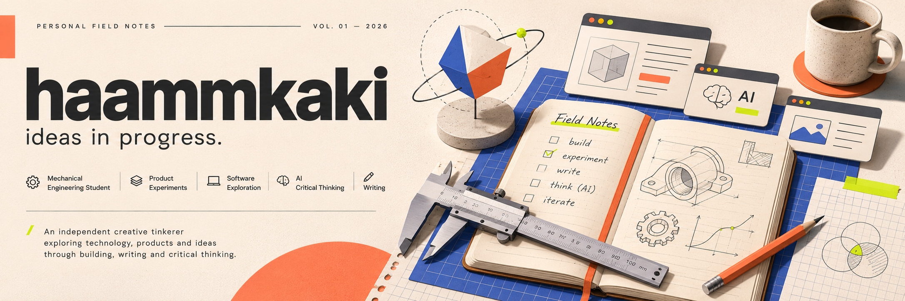

<!-- haammkaki / personal field notes -->

 

### A place to make sense of things.

I'm Hamka, a Mechanical Engineering undergraduate at Udayana University, Indonesia.

I like exploring the space between engineering, technology, design, and ideas. Some of my work turns into a small digital product; some stays an experiment, a sketch, or a written note. I use this space to keep track of what I'm trying, learning, and questioning.

**Currently exploring**

- Small web tools and product prototypes
- Engineering problems and hands-on learning
- Human-centered interfaces and visual experiments
- AI, independent thinking, and responsible use of technology

---

#### The notebook

| Shelf | What's inside |
| :-- | :-- |
| **Build** | Small tools, prototypes, and experiments, documented as they evolve. |
| **Think** | Notes on technology, AI, decision-making, and ideas worth examining. |
| **Make** | Visual studies, layouts, and playful interfaces. |
| **Learn** | Engineering exercises and things I am still figuring out. |

This is a working notebook, not a list of finished achievements. Projects will be linked here when they are ready to share.

Made with curiosity, revised with evidence. · Bali, Indonesia
